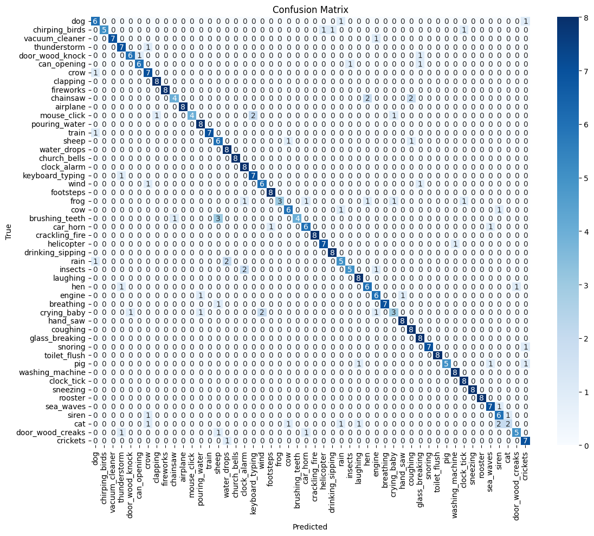
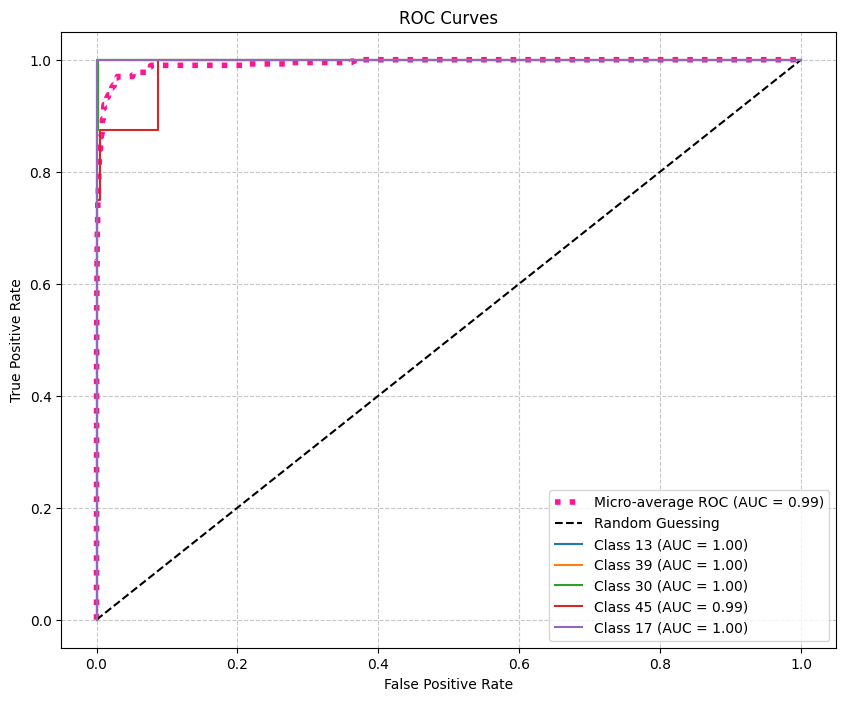
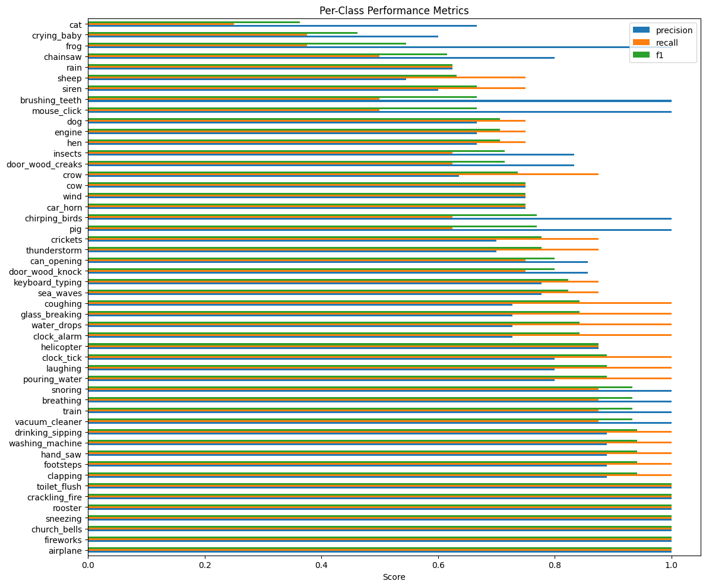
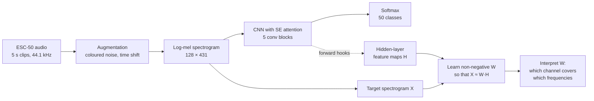
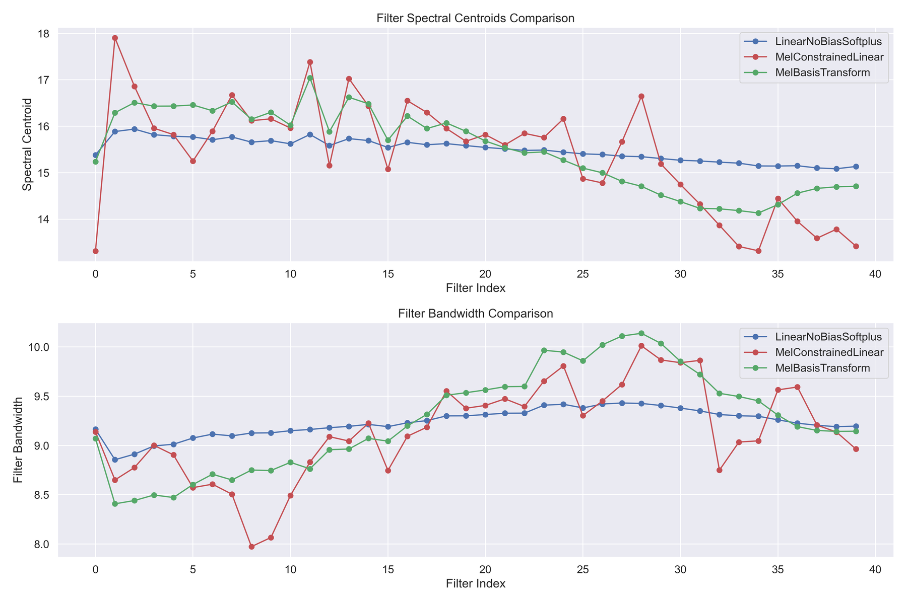
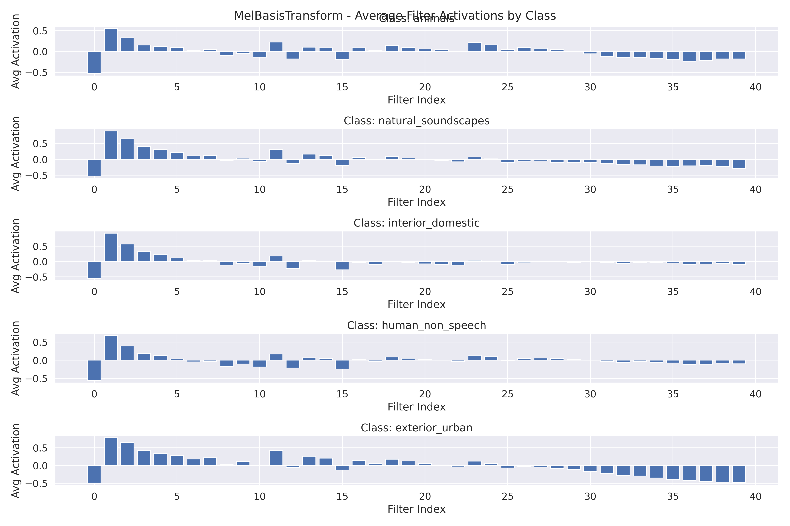

# Interpreting CNN Hidden Layers for Environmental Sound Classification with NMF

Bachelor's thesis project, Faculty of Automatic Control, Robotics and Electrical Engineering, Poznań University of Technology.
Supervisor: dr hab. Szymon Drgas. [Read the full thesis (PDF)](thesis.pdf)

A convolutional neural network classifies the 50 sound categories of the [ESC-50 dataset](https://github.com/karolpiczak/ESC-50) from mel spectrograms. The second, more interesting part of the project asks *what the network has learned*: activations from its hidden layers are used as the activation matrix **H** in an NMF-style decomposition of the input spectrogram, **X ≈ W·H**, where **W** is a small learned non-negative basis. Looking at **W** shows which frequency regions each hidden channel is responsible for.

## Results at a glance

| Metric | Result |
|---|---|
| Best validation accuracy | **88.5%** |
| Accuracy on the 400-clip held-out fold (confusion matrix below) | **81.75%** (327 / 400) |
| Micro-average ROC AUC | **0.99** |
| Model size | 21.6 M parameters |
| Training hardware | Google Colab, Tesla T4, about 21 s per epoch |

For context, the original ESC-50 paper reports a human accuracy of 81.3% on this dataset.

<p align="center">
  
</p>

Seven classes were classified perfectly (airplane, fireworks, church bells, sneezing, rooster, crackling fire, toilet flush). The hardest were **cat** (2 / 8, twice mistaken for siren), **crying baby** and **frog** (3 / 8 each), and **brushing teeth**, which the model confused with sheep three times.

<p align="center">
  
  
</p>

## How it works



**1. Preprocessing** (`preprocessing.ipynb`)
- Audio resampled to 44.1 kHz and converted to log-mel spectrograms: 128 mel bands, FFT size 2048, hop 512, 20 Hz to 22.05 kHz.
- Each spectrogram is normalised (zero mean, unit variance) and padded or truncated to 431 frames.
- Training clips are augmented with white, pink or brown noise at 15 dB SNR and a random time shift of up to 20%.
- ESC-50's predefined folds are used: folds 1–3 for training, fold 4 for validation, fold 5 for testing.

**2. Classifier**
- Five convolutional blocks (Conv → BatchNorm → ReLU → MaxPool); channels grow from 1 to 1024 while the 128 × 431 input shrinks to 52 spatial elements.
- Squeeze-and-excitation channel attention after blocks 2–5, using both average and max pooling, reduction ratio 8. It adds only 2.4% of the parameters.
- Classification head: 1536 → 512 → 256 → 50, with dropout 0.5.
- Trained with Adam (learning rate 0.001), batch size 32, mixup, learning-rate reduction on plateau and early stopping, for up to 300 epochs.

**3. Interpretability** (`main.py`, `graphics.py`)
- Forward hooks capture feature maps from a hidden convolutional layer (32 channels).
- Three small non-negative models learn the mapping from those 32 channels to a 40-band mel spectrogram, trained for 200 epochs on mean squared error, with a spectral smoothness penalty on the first two:

| Model | Idea | What it showed |
|---|---|---|
| `LinearNoBiasSoftplus` | Unconstrained linear map, weights kept positive with Softplus, no bias | Captures high-energy regions well, but the reconstructions are the noisiest |
| `MelConstrainedLinear` | Learnable triangular, mel-like filters (centres and bandwidths are trained) | Smoothest, most mel-aligned output, but loses fine detail |
| `MelBasisTransform` | Starts from a fixed Gaussian mel-like basis and adapts slightly | A middle ground: structured like the mel scale, still adapts to the data |

<p align="center">
  
</p>

The plot above compares the spectral centroid and bandwidth of each learned filter. The linear model's filters are almost uniform, while the two mel-based models vary much more from filter to filter, meaning their filters specialise in different frequency regions.

`graphics.py` also groups the learned filter activations by the five ESC-50 major categories (animals, natural soundscapes, human non-speech, interior/domestic, exterior/urban; 400 clips each). Exterior/urban sounds, for example, drive the highest filters (30–39) strongly negative, while interior/domestic sounds leave them almost flat.

<p align="center">
  
</p>

> **Note (October 2026):** an earlier version of `graphics.py` could not read the class from the feature-map filenames and grouped the samples under placeholder labels. This was fixed in [pull request #1](https://github.com/roshdwivedi/ESC_classifier/pull/1): the plots in `activation_analysis_results/` were regenerated with the real ESC-50 categories, after retraining the three interpretable models. Their filter plots can therefore differ slightly from the figures in the thesis. The classifier and its results are not affected.

## Repository contents

| Path | What it is |
|---|---|
| `preprocessing.ipynb` | Loading, augmentation, mel spectrograms and the fold-based train/val/test split |
| `classifier_nn.ipynb` | CNN classifier: architecture, training run (best validation accuracy 88.5%) and hook-based feature extraction |
| `main.py` | Trains the three interpretable models on the extracted feature maps and saves their weights, filter plots and loss curves |
| `graphics.py` | Filter-bank plots, per-category analysis, model comparisons and an HTML report in `activation_analysis_results/` |
| `activation_analysis_results/` | Generated plots and `analysis_report.html` |
| `AllModelResults.zip` | Filter snapshots every 20 epochs and loss curves for each interpretable model |
| `docs/images/` | Result figures from the thesis |
| `thesis.pdf` | The full thesis |

## Running it

1. Download [ESC-50](https://github.com/karolpiczak/ESC-50). The notebooks were written for Google Colab and expect the dataset in Google Drive at `My Drive/ESC-50-Dataset/ESC-50-master`; change `dataset_dir` if yours is elsewhere.
2. Run `preprocessing.ipynb`, then `classifier_nn.ipynb` to train the classifier and extract the hidden-layer feature maps to `extracted_features/feature_maps/feature_map_<id>.npy`, with the matching spectrograms in `extracted_features/spectrograms/spectrogram_<id>.npy`.
3. Train the interpretable models and generate the analysis:

```bash
pip install -r requirements.txt
python main.py       # trains the three models, saves *.pth weights and plots
python graphics.py   # writes plots and analysis_report.html to activation_analysis_results/
```

## Limitations

- ESC-50 is small (2,000 clips, 40 per class), and results come from a single fold split rather than full 5-fold cross-validation.
- With 21.6 M parameters the classifier is large for the dataset, and it is not optimised for real-time use.

## Author

Roshan Dwivedi, BSc Automatic Control and Robotics, Poznań University of Technology.
